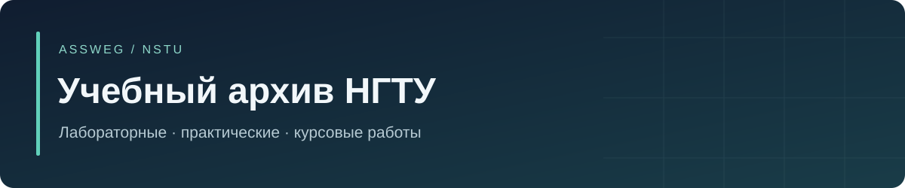

# Учебные репозитории Assweg

Каждая лабораторная, практическая и курсовая работа хранится в своём репозитории. Внутри — её исходники и материалы, отчёты и отдельный README. Этот репозиторий служит каталогом ссылок.

`C++` · `Swift` · `JavaScript / React / Express` · `PostgreSQL / PLpgSQL` · `Python / Jupyter` · `Go` · `Docker`

## 2 семестр

| Работа | Репозиторий | Материалы |
|---|---|---|
| Лабораторная №1 · геометрия и Git | [1laba_2sem](https://github.com/Assweg/1laba_2sem) | Исходники и материалы |
| Лабораторная №2 · Три задачи на разных языках | [2laba_2sem](https://github.com/Assweg/2laba_2sem) | Исходники и материалы |
| Лабораторная №3 · Функции, простые числа и охлаждение | [3laba_2sem](https://github.com/Assweg/3laba_2sem) | Исходники и материалы |
| Лабораторная №4 · Численные методы и статистика | [4laba_2sem](https://github.com/Assweg/4laba_2sem) | Исходники и материалы |
| Лабораторная №5 · Модели склада, очереди и транспорта | [5laba_2sem](https://github.com/Assweg/5laba_2sem) | Исходники и материалы |
| Лабораторная №6 · Матрицы, шифр и системы уравнений | [6laba_2sem](https://github.com/Assweg/6laba_2sem) | Исходники и материалы |
| Лабораторная №7 · Калькулятор и цепочки чисел | [7laba_2sem](https://github.com/Assweg/7laba_2sem) | Исходники и материалы |
| Практическая №1 · сборка программ из консоли | [1prac_2sem](https://github.com/Assweg/1prac_2sem) | Отчёт / документ |
| Практическая №2 · модульная арифметика | [2prac_2sem](https://github.com/Assweg/2prac_2sem) | Исходники и материалы |
| Практическая №3 · прикладные алгоритмы | [3prac_2sem](https://github.com/Assweg/3prac_2sem) | Исходники и материалы |

## 3 семестр

| Работа | Репозиторий | Материалы |
|---|---|---|
| Лабораторная №1 · Структуры данных | [1laba_3sem](https://github.com/Assweg/1laba_3sem) | Исходники и материалы |
| Лабораторная №2 · Применение структур данных | [2laba_3sem](https://github.com/Assweg/2laba_3sem) | Исходники и материалы |
| Лабораторная №3 · Тестирование и сериализация | [3laba_3sem](https://github.com/Assweg/3laba_3sem) | Исходники и материалы |
| Лабораторная №4 · Потоки и синхронизация | [4laba_3sem](https://github.com/Assweg/4laba_3sem) | Исходники и материалы |
| Лабораторная №5 · Консольный маркетплейс | [5laba_3sem](https://github.com/Assweg/5laba_3sem) | Исходники и материалы |
| Практическая №1 · сервер мини-СУБД | [1prac_3sem](https://github.com/Assweg/1prac_3sem) | Исходники и материалы |
| Практическая №2 · многопоточный сервер | [2prac_3sem](https://github.com/Assweg/2prac_3sem) | Исходники и материалы |
| Практическая №3 · учебная криптобиржа | [3prac_3sem](https://github.com/Assweg/3prac_3sem) | Исходники и материалы |

## 4 семестр

| Работа | Репозиторий | Материалы |
|---|---|---|
| Курсовой проект · учебная платформа по криптографии | [crpted2](https://github.com/Assweg/crpted2) | Исходники и материалы |
| ТиМП · лабораторная №1, интерфейс мониторинга | [1laba_4sem](https://github.com/Assweg/1laba_4sem) | Исходники и материалы |
| ТиМП · лабораторная №4, мониторинг энергообъектов | [4laba_4sem](https://github.com/Assweg/4laba_4sem) | Исходники и материалы |
| ТиМП · РГР, журнал событий безопасности | [rgr_4sem](https://github.com/Assweg/rgr_4sem) | Исходники и материалы |

## 5 семестр

| Работа | Репозиторий | Материалы |
|---|---|---|
| БСБД · лабораторная №1 | [laba1_bsbd](https://github.com/Assweg/laba1_bsbd) | Исходники и материалы |
| БСБД · лабораторная №2 | [laba2_bsbd](https://github.com/Assweg/laba2_bsbd) | Исходники и материалы |
| БСБД · лабораторная №3 | [laba3_bsbd](https://github.com/Assweg/laba3_bsbd) | Исходники и материалы |
| БСБД · лабораторная №4 | [laba4_bsbd](https://github.com/Assweg/laba4_bsbd) | Исходники и материалы |
| БСБД · расчётно-графическое задание | [rgz_bsbd](https://github.com/Assweg/rgz_bsbd) | Исходники и материалы |
| ТиМП · лабораторная №2, материалы PostgreSQL | [2laba_timp](https://github.com/Assweg/2laba_timp) | Исходники и материалы |
| ТиМП · лабораторная №3, сетевой стенд | [3laba_timp](https://github.com/Assweg/3laba_timp) | Исходники и материалы |
| ТиМП · практическая №1, проектирование приложения | [1prac_timp](https://github.com/Assweg/1prac_timp) | Отчёт / документ |
| ТиМП · практическая №2, развёртывание VDS | [2prac_timp](https://github.com/Assweg/2prac_timp) | Отчёт / документ |
| ТиМП · практическая №3, функции и триггеры БД | [3prac_timp](https://github.com/Assweg/3prac_timp) | Отчёт / документ |
| Сети и системы передачи информации · ЛР1, диагностика сети | [1laba_sispi](https://github.com/Assweg/1laba_sispi) | Отчёт / документ |
| Сети и системы передачи информации · ЛР2, Wireshark | [2laba_sispi](https://github.com/Assweg/2laba_sispi) | Отчёт / документ |
| Сети и системы передачи информации · ЛР3, IP-подсети | [3laba_sispi](https://github.com/Assweg/3laba_sispi) | Отчёт / документ |
| Сети и системы передачи информации · ЛР4, DHCP | [4laba_sispi](https://github.com/Assweg/4laba_sispi) | Отчёт / документ |
| ТООС · лабораторная работа №1 | [1laba_toos](https://github.com/Assweg/1laba_toos) | Отчёт / документ |
| Метрология · расчётно-графическая работа | [rgr_metrology](https://github.com/Assweg/rgr_metrology) | Отчёт / документ |
| ОИБ · доклад об аккредитации | [oib-report](https://github.com/Assweg/oib-report) | Отчёт / документ |

## 6 семестр

| Работа | Репозиторий | Материалы |
|---|---|---|
| БСБД · лабораторная №1, шестой семестр | [1laba_bsbd_6sem](https://github.com/Assweg/1laba_bsbd_6sem) | Исходники и материалы |
| БСБД · лабораторная №2, шестой семестр | [2laba_bsbd_6sem](https://github.com/Assweg/2laba_bsbd_6sem) | Исходники и материалы |
| БСБД · лабораторная №3, шестой семестр | [3laba_bsbd_6sem](https://github.com/Assweg/3laba_bsbd_6sem) | Исходники и материалы |
| БСБД · лабораторная №4, шестой семестр | [4laba_bsbd_6sem](https://github.com/Assweg/4laba_bsbd_6sem) | Исходники и материалы |
| БСБД · курсовые материалы шестого семестра | [coursework_bsbd_6sem](https://github.com/Assweg/coursework_bsbd_6sem) | Исходники и материалы |

## 7 семестр

| Работа | Репозиторий | Материалы |
|---|---|---|
| Искусственный интеллект · лабораторная №1 | [1laba_ai_7sem](https://github.com/Assweg/1laba_ai_7sem) | Исходники и материалы |
| Проектирование систем защиты · определение уровня защищённости | [1prac_security_design_7sem](https://github.com/Assweg/1prac_security_design_7sem) | Отчёт / документ |

## Дополнительные материалы

| Работа | Репозиторий | Материалы |
|---|---|---|
| Eltex · подготовка к экзамену | [eltex-exam-preparation](https://github.com/Assweg/eltex-exam-preparation) | Отчёт / документ |

## Другие версии и незаполненные работы

- [crpted](https://github.com/Assweg/crpted) — предыдущая итерация курсового проекта.
- [1laba_3sem_false](https://github.com/Assweg/1laba_3sem_false) — ранний вариант первой лабораторной по структурам данных.
- [RGR_2sem](https://github.com/Assweg/RGR_2sem) — исходники и отчёт РГР не найдены.
- [6laba_3sem](https://github.com/Assweg/6laba_3sem) — исходные материалы шестой лабораторной не найдены.

## Как устроены репозитории

В каждом README указан фактический состав работы. Если найден только отчёт, это отмечено явно. Разные локальные варианты одной лабораторной сохраняются внутри её репозитория; они не смешиваются с другими заданиями. Отличающийся локальный вариант ранее опубликованного кода находится в `local-version/`.

Маркировка семестров в старых репозиториях местами отличается от локальных папок. Существующие имена репозиториев сохранены, чтобы не ломать адреса проектов.

VPN-профиль, приватные SSH/TLS/PGP-ключи, ключи шифрования БД, файлы учётных записей, журналы и резервные копии не публиковались. Для соответствующих учебных стендов подготовьте свою локальную конфигурацию. Установленные зависимости и сборки в новые репозитории не включены.

Полная сборка всех проектов и повторное выполнение Notebook при публикации не проводились. Инструкции отражают сохранённые материалы; ограничения отмечены в README каждой работы.

## Происхождение материалов

[Карта распределения файлов и контрольные суммы](docs/publication-map.json) связывает исходные файлы с отдельными репозиториями. Общие сторонние заголовки оставлены в [references/Library](references/Library/); уведомления об авторстве внутри них сохранены.

---

[Профиль Assweg](https://github.com/Assweg)
